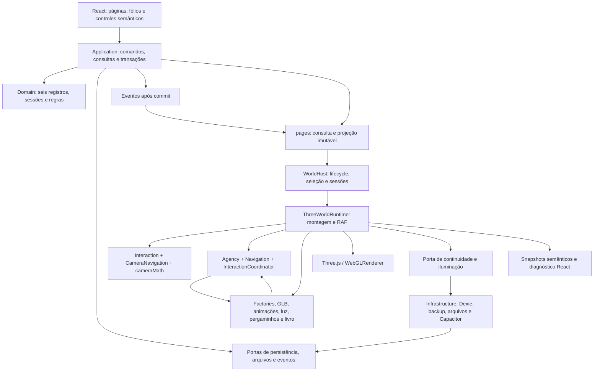

# Biblioteca Viva — auditoria de arquitetura, desempenho e stack

Data: 06/11/2026. Auditoria independente de implementação; nenhuma correção de produção, asset, schema, merge ou protótipo de engine foi executado. **Recomendação estratégica: substituir gradualmente o subsistema de mundo por Godot 4/GDScript, conservando inicialmente o aplicativo React/Capacitor e seus dados. A autorização de migração deve depender do estudo mínimo da Parte IX. Não existe evidência para prometer melhora de FPS com a troca.** Segunda opção: recuperação delimitada do runtime atual se o estudo mostrar que a integração/editor Godot custa mais do que economiza.

## Escopo, proveniência e limites

- Checkout auditado: `254ae15d48a10896d00b8a6b539532725375d13c`, branch `feat/bf-5-5f-real-session-response`. Checkout original limpo e mantido na mesma branch. Documentação produzida em worktree isolado, branch `audit/bv-arquitetura-performance-stack`.
- PR [#37](https://github.com/Samuel-Francisco-AS/biblioteca-viva/pull/37) consultada pelo conector: aberta/draft, head igual ao checkout, base E `3ca9366`. Nenhuma PR modificada. Seus 26 arquivos / +1.835 −46 são apenas F contra E, não toda BF-5.5.
- `main` local: `f35258c`, anterior às Partes 2. `origin/main` disponível: `360aac1`. Fechamento BF-5 integrado: `1df8adadb153e41d068f5d98e899dacb8d18de74`; head funcional integrado `f7c79ae`. Comparações de conteúdo usam explicitamente essas bases; refs remotas locais não foram atualizadas por fetch nesta rodada.
- Contra fechamento BF-5: 81 arquivos, +7.339 −224; contra `origin/main`: 75 arquivos, +6.891 −340; contra `main` local: 322 arquivos, +27.434 −1.443. Não converter essas contagens em qualidade ou horas trabalhadas. A candidata tem história independente da integração da main; diferenças incluem documentação e reconciliações ainda futuras.
- Autoridades examinadas: STATUS e índice documental, README, ROADMAP, ARCHITECTURE, WORLD, PERFORMANCE, TESTING, ANDROID, ART_DIRECTION; índice de ADRs e ADR-009/023; fechamento BF-5; relatórios BF-4G, BF-5R7 e A–F da BF-5.5, auditoria preliminar D. Evidências de BF-3 e BF-4 foram também confrontadas pelos índices/contratos e consolidações, sem reexecutar seus gates. Histórico não foi usado como autorização. Não se alega leitura linha a linha de todos os arquivos do projeto.
- Inspeção de produção, testes arquiteturais/geométricos, factories, scripts, configurações, lockfile, CI e Android; varredura de imports de 233 módulos de produção. Foi uma rodada sistemática orientada aos fluxos, não revisão formal exaustiva de cada regra de negócio.
- `adb devices -l`: **nenhum dispositivo conectado**. Moto G06, versão atual do WebView, GPU/driver, RAM efetiva, temperatura, throttling, input-to-photon, heap e memória do processo **NÃO VERIFICADOS nesta rodada**. Não inferimos esses atributos a partir do nome comercial. Evidência histórica descreve Android 15/API 35; não confirma a instalação atual.
- CI do HEAD: [run 42210455500](https://github.com/Samuel-Francisco-AS/biblioteca-viva/actions/runs/42210455500), concluída FAIL. `Static, unit and build gates` SUCCESS, E2E shard 1/2 FAIL e 2/2 FAIL. Consultados jobs/steps, não classificados todos os traces. Os 31 PASS / 35 FAIL citados na PR pertencem a `43d2c82`, não são contagem auditada do HEAD. Falhas novas versus antigas no HEAD continuam sem classificação causal.

**Vocabulário:** CONFIRMADO = código/teste/medição demonstra o fato descrito; PROVÁVEL = mecanismo forte, impacto ainda sem medição conclusiva; HIPÓTESE = precisa experimento; NÃO VERIFICADO = cobertura insuficiente. Confirmar trabalho redundante não confirma que ele explica sozinho a lentidão relatada. Severidade representa risco ao produto; esforço representa ordem de grandeza para uma pessoa familiarizada com o projeto, com validação, sem promessa de prazo.

## Parte I — Diagnóstico executivo

A aplicação tem duas situações distintas. O catálogo local-first possui fronteiras úteis, contratos de dados, validação e testes reaproveitáveis. O mundo está evoluindo de demonstração de renderer para uma pequena engine própria, composta de agendamento, navegação, reservas, colisão aproximada, animação, coreografia, efeitos, continuidade e ferramentas diagnósticas. Three.js fornece renderização e primitivas; o projeto assumiu a integração de sistemas de jogo e também a autoria da cena em TypeScript.

O problema atual é **combinação de implementação, crescimento arquitetural e pipeline artístico**. A plataforma WebView é um suspeito, não culpado demonstrado. Há trabalho evitável no input e no frame; a BF-5.5 aumentou materialmente conteúdo geométrico, iluminação e consultas espaciais sem novo gate físico. A evidência histórica de ~60 FPS em cenas anteriores não aprova a candidata. Tampouco SwiftShader lento demonstra incapacidade do Moto G06.

A inadequação mais bem demonstrada para o futuro RPG é de **custo de autoria e evolução**, não impossibilidade de renderização WebGL. Sentar requer abordagem, alinhamento, rig/clip adequado, contato, exclusividade e saída: o código atual constrói grande parte disso a partir de envelopes de meshes e coordenadas de móveis. Esse custo tende a crescer com party, masmorras, combate e habilidades. Uma engine reduz infraestrutura espacial e oferece edição/inspeção de cenas; não escreve regras narrativas, combate ou migração de dados automaticamente.

**É possível recuperar fluidez na stack atual? Há mecanismos corrigíveis claros e a hipótese é plausível. Não está demonstrado que bastam, nem que atendem à visão futura a custo proporcional.** Por isso não recomendo investir primeiro numa grande reorganização Three.js nem reescrever o catálogo em Kotlin. Recomendo validar a extração do mundo para Godot, cujo benefício central é eliminar parte do trabalho de engine/autoria. Se a prova falhar em integração, acessibilidade ou ambiente de desenvolvimento, recuperar Three.js com limite explícito de investimento é uma opção racional.

## Parte II — Mapa arquitetural real

| Subsistema / arquivos principais                                                         | Responsabilidade e fluxo observado                                                                                                           |
| ---------------------------------------------------------------------------------------- | -------------------------------------------------------------------------------------------------------------------------------------------- |
| `src/domain/*`                                                                           | Entidades/regras, schemas, sessões, treinos, empreitadas, eventos; sem necessidade de Three/React para os cálculos centrais                  |
| `src/application/*`, `src/app/createApplication.ts`                                      | Composição de casos de uso/portas, transações, publicação; `sessions.ts:263–288,368–413` publica depois da transação nos caminhos examinados |
| `src/infrastructure/database/{database,schema,repositories}.ts`                          | Dexie v14, repositórios, parsing; listas gerais usam `toArray`, validação e ordenação. Sem consulta DB no RAF                                |
| `src/infrastructure/backup/*`, `files/*`                                                 | Codec/validação, snapshot, restore e arquivos nativos; contrato backup v6 e dívida de restore preservados                                    |
| `src/pages.tsx:211–262`                                                                  | Consulta entradas, notas, citações e sessão; projeções neutras; compara JSON; reconsulta em SessionChanged/reativação                        |
| `libraryWorldEntries.ts`, `libraryRecordLayout.ts`, `readingAreaBookLayout.ts`           | Identidade lógica e seleção de ocorrências/slots: até 70 livros + 13 outros registros; excedente continua React                              |
| `WorldHost.tsx:33–90,141–413`                                                            | Carrega continuidade, importa runtime, monta/descarta, transmite sessão e narrativa; pausa por aba, timers de contexto                       |
| `ThreeWorldRuntime.ts:587–906,1260–1361`                                                 | Compõe cena e recursos, um RAF; agência, clips e efeitos antes de render; publica diagnóstico                                                |
| `ThreeWorldInteraction.ts`, `CameraNavigation.ts`, `cameraMath.ts`                       | Pointer capture, máquina de gesto tap/pan/pinch, câmera imperativa e picking. React não interpola a câmera                                   |
| `inhabitantAgency.ts`, `inhabitantNavigation.ts`, `inhabitantInteractions.ts`            | Uma autoridade de movimento; quatro agentes, relações, tarefas, leases; grafo de visibilidade e obstáculos                                   |
| `livingVisuals.ts`, `livingScrollVisuals.ts`, `sessionBookVisuals.ts`                    | Movimento/representação de props, pergaminhos e livro pessoal; callbacks à agência e coordenador compartilhado                               |
| `proceduralLibraryBuilding.ts`, `proceduralLibraryFurnishing.ts`, `proceduralContent.ts` | Arquitetura, móveis, estantes/livros em factories e batches; contratos físicos amarrados à apresentação                                      |
| `inhabitantVisuals.ts`, `inhabitantAnimator.ts`                                          | Quatro loaders GLB, AnimationMixers, âncoras de transporte e clips                                                                           |
| `narrative/*`, `narrativeVisuals.ts`, `NarrativePanel.tsx`                               | Histórias locais em grafos, fatos/vínculos e efeitos; sessão narrativa separada de sessão convencional                                       |
| Android                                                                                  | `MainActivity` hospeda BridgeActivity, registra backup/imagem/haptic e insets; não implementa render/input 3D nativo                         |

### Mudanças e possíveis regressões desde BF-5

| Frente | Mudança rastreada                                               | Interpretação causal                                                              |
| ------ | --------------------------------------------------------------- | --------------------------------------------------------------------------------- |
| A      | Continuidade, load antes de montar, checkpoint 12 s e lifecycle | Pode acrescentar espera na abertura e escrita ocasional; não explica DB por gesto |
| B      | InteractionCoordinator, tarefas físicas e recuperação           | Acrescenta verificações/estados; preserva autoridade única                        |
| C      | Nove luzes pontuais, ciclo/ritual/checkpoint                    | Candidata a custo de GPU e agência; comparar dia/noite sem inferir culpado        |
| D      | Magia ambiental e até dez pergaminhos, voo e seleção            | Acrescenta efeitos transparentes, update/trilhas e objetos no picking             |
| E      | Reforma de mobília/estantes e material/specular                 | Maior mudança estrutural medida de conteúdo; decoração também aumenta obstáculos  |
| F      | Sessão real, livro canônico articulado/voador e reconsulta      | Acrescenta planejamento, bounds e coordenação; pode gerar bursts mesmo sem pan    |

`cameraMath.ts` e `CameraNavigation.ts` **não mudaram desde o fechamento BF-5**. A redundância BV-01 é dívida anterior, não regressão introduzida em F. No input, o diff acrescenta `scroll:` aos alvos ambientais de picking. A piora recente pode resultar da carga nova competindo com um caminho já custoso; sem perfil não é possível atribuí-la a um único commit. O fato de package/lock não mudarem entre essas bases enfraquece a hipótese de regressão causada por upgrade de Three/React nesse intervalo.

### Dependências e integração

A varredura conservadora de imports relativos encontrou 796 arestas e três componentes cíclicos: (1) `domain/{validation,endeavors,schemas,workouts,entertainment,types}`, (2) `domain/{milestones,events}`, (3) `EntryDetailPage` e os quatro detalhes especializados. **Inclui imports de tipos:** `milestones → events` e os detalhes → `EntryDetailApplication` são exemplos; não há evidência de deadlock ou ciclo executável por esses resultados. A varredura não resolve todos os barrels, imports dinâmicos/aliases, nem distingue todos os símbolos apagados no build. Não foi demonstrado ciclo executável causador de performance; extrair tipos pode simplificar fronteiras, mas tem prioridade baixa.

O acoplamento crítico é comportamental: runtime monta agência com callbacks que consultam visuais do livro/pergaminho; visuais consultam leases da agência; ambos consomem a mesma geometria. Isso não constitui necessariamente ciclo de imports, mas torna ordem de update, propriedade de transformação, pausa e recuperação contratos frágeis. `DexieInhabitantContinuityRepository` importa contrato da feature visual: direção de dependência aceitável como porta hoje, porém portabilidade exigirá mover esse contrato neutro para uma localização independente de UI.

Há boas decisões preserváveis: IDs separados de representação, wrapper selecionável, eventos após commit, runtime sem Dexie, fila de gravações de continuidade, um RAF e fallback semântico. Não há evidência para eliminar essas fronteiras em nome de simplicidade.

## Parte III — Inventário de gargalos e riscos

### Diagnóstico controlado executado

Factories reais foram executadas em Node 24.18.0/Vitest 4.1.10/jsdom, sem WebGL, em dois worktrees: BF-5 integrada e candidata. Mesmo lockfile de renderização/dependências; **nenhuma alteração em package/package-lock entre as duas bases**. Teste monta exclusivamente `createProceduralLibraryBuilding(true)` e três estantes `createProceduralComposition(LIBRARY_SHELVES)`. Não inclui GLBs, registros pessoais, luzes/efeitos criados pelo runtime ou pergaminhos. Contagem total por instância, sem culling, distinta de geometria GPU única.

| Métrica estrutural desse subconjunto                 | BF-5 `1df8ada` | Candidata `254ae15` |
| ---------------------------------------------------- | -------------: | ------------------: |
| Nós incluindo root diagnóstica                       |            100 |                 204 |
| Meshes, contando InstancedMesh como um nó            |             72 |                 173 |
| Instâncias efetivas, incluindo meshes comuns         |          1.109 |               1.655 |
| Triângulos potenciais somados por instância          |         27.012 |             152.224 |
| Vértices de atributos position somados por instância |         42.551 |             141.141 |
| Geometrias únicas por identidade                     |             42 |                  56 |
| Materiais únicos por identidade                      |             23 |                  41 |
| Texturas referidas por materiais, únicas             |              0 |                   4 |
| Meshes com material transparent nesse subconjunto    |              0 |                   0 |
| Obstáculos coletados                                 |            805 |               1.114 |
| Nós de navegação                                     |            136 |                 138 |

Aumento de triângulos ≈5,64× e meshes ≈2,40× **não prova excesso para a GPU**, mas invalida tratar a candidata como a cena anteriormente aceita. Instancing evita uma call por detalhe; ao mesmo tempo as instâncias continuam custando em vértices e na extração de obstáculos. O culling é por mesh/batch, não descarte individual de cada detalhe de um InstancedMesh ambiental.

Como diagnóstico de mecanismo, uma rota fria `(0,0) → (-12,6)`, raio 0,45, consumiu ~157 ms na base e ~205 ms na candidata no host desta execução. Pan de 300 eventos em 412×840: mediana ~0,448/0,468 ms, P95 ~0,716/0,948 ms, máximos ~2,018/2,224 ms respectivamente. **Não são benchmark comparativo controlado**: processos executaram próximos/concorrentemente, sem isolamento térmico, sem warmup estatístico e fora do aparelho. Não usar diferenças percentuais de tempo como regressão medida. Demonstram execução síncrona e que construir grafo frio pode produzir tarefa longa mesmo no host; não caracterizam pan Android ou frequência de spikes. O primeiro registro foi suprimido pelos mocks de console do setup; uma segunda captura diagnóstica foi feita gravando JSON, sem mudar algoritmo, timeout ou assert.

Evidência reproduzível: [diretório de evidências](evidence/bv-stack-2026-11-06/), com código diagnóstico em `.txt`, JSON das duas bases e inventário de bundle. Copiar o `.txt` para `audit-diagnostic.test.ts` **somente em worktree descartável**, linkar dependências instaladas correspondentes e executar Vitest. O destino JSON temporário no script identifica a captura; ajustar o nome para a base. Não adicionar esse teste de timing à CI.

Rodada dirigida: **45 testes PASS / 5 arquivos**, dos quais 44 são testes existentes de fronteiras, câmera, livro de sessão e rotas de pergaminho; um é o diagnóstico descartável. Captura final: um teste diagnóstico PASS em cada base. Build Vite isolado PASS, warning >500 kB mantido; não executa tsc e não equivale a `npm run build` completo. O gate completo pertence à CI consultada. Sem E2E global local, Gradle, instalação ou medição física.

### Registro de problemas

Todos os caminhos abaixo são relativos à raiz do checkout auditado. Linhas referem-se a `254ae15`; intervalos delimitam a implementação, não um stack trace. A confiança refere-se ao mecanismo; o impacto físico continua limitado pelo escopo acima. Priorização: **P1** dados/fluidez/decisão de fundação, **P2** custo cumulativo e manutenção, **P3** higiene diagnóstica. Nenhum vazamento, ANR ou corrupção foi reproduzido nesta auditoria.

| ID / subsistema / severidade                    | Local e descrição técnica                                                                                                                                                                                                                                | Evidência, confiança e reprodução                                                                                                                                                                                                                   | Impacto estimado / alternativa / risco / esforço                                                                                                                                                                                                                                                  |
| ----------------------------------------------- | -------------------------------------------------------------------------------------------------------------------------------------------------------------------------------------------------------------------------------------------------------- | --------------------------------------------------------------------------------------------------------------------------------------------------------------------------------------------------------------------------------------------------- | ------------------------------------------------------------------------------------------------------------------------------------------------------------------------------------------------------------------------------------------------------------------------------------------------- |
| BV-01 Input, alta/P1                            | `three/cameraMath.ts:470–598,663–770`; `CameraNavigation.ts:43–58,106–122`: reconstrução de convex hull, inset/expansão e ordenação de regiões por cômodo em cada clamp                                                                                  | **CONFIRMADO**, alta: pan chama clamp quatro vezes internamente, mais commit = cinco; pinch usual três + commit = quatro. Cinco cômodos dão até 25/20 construções de restrições por evento válido. Pan/pinch contínuos; custo medido apenas no host | CPU/alocação evitáveis justamente no gesto; cache por pisos/viewport/zoom, normalizar uma vez e reduzir evento à última posição por frame. Risco médio de alterar limites/foco/gesto; 2–5 dias com regressão focal                                                                                |
| BV-02 Navegação, alta/P1                        | `inhabitantNavigation.ts:128–229`: grafo frio testa pares de nós contra todos obstáculos; Dijkstra varre mínimos linearmente                                                                                                                             | **CONFIRMADO**, alta: grafo lazy por raio, diagnóstico frio acima; agentes/replanejamento/livro aéreo podem construí-lo na thread JS                                                                                                                | Spikes de CPU. Grafo frio O(N²·O), mais cobertura de pisos; rota quente O(N²+E·A), links O(N·O). Separar colisores autorais simples, pré-construir grafo fora de gesto, ou NavigationServer. Risco alto de rotas incorretas; 1–3 semanas                                                          |
| BV-03 Geometria/colisões, alta/P1               | `three/inhabitantObstacles.ts:20–60`, `scrollFlightRoutes.ts:34–90`, `sessionBookVisuals.ts:119–205`: detalhes renderizados tornam-se obstáculos; flightObstacles recalcula bounding boxes/instâncias e até 64 caixas por toro                           | **CONFIRMADO**, alta: inventário 1.114 obstáculos só cenário/estantes; coleta de agência e pergaminhos na montagem; reconstrução de voo a cada tentativa elegível (intervalo 2 s)                                                                   | Startup e bursts, falsos bloqueios de envelopes, custo de mudar arte. Não é coleta global por frame. Separar visual/collider/nav e cache versionado; risco alto de atravessar móveis se simplificar sem contrato; 1–3 semanas                                                                     |
| BV-04 Render/GPU, alta/P1                       | `proceduralLibraryFurnishing.ts:1–955`, `proceduralContent.ts:1–601`, `livingVisuals.ts:221–246`; runtime `:805–806`                                                                                                                                     | Conteúdo maior **CONFIRMADO**, gargalo GPU **PROVÁVEL**, confiança média: mais meshes/triângulos/materiais, nove PointLights automáticas, Standard/Phong e DPR até 2. Reproduzir cena rica/noite/zoom                                               | Draw submission, vértices, fragmentos e iluminação podem dominar; medir renderer.info e GPU/frame antes de reduzir arte. Batches coerentes, luz baked/emissiva conforme arte, resolução adaptada só se medição justificar. Risco médio/alto artístico; diagnóstico 1–2 dias, correção 1–3 semanas |
| BV-05 Frame CPU, média/P2                       | `livingVisuals.ts:332–487`: percorre scene inteira por frame para localizar Hemisphere/Directional lights e interpolar valores estáveis                                                                                                                  | **CONFIRMADO**, alta: scene.traverse no update mesmo em atmosfera estável                                                                                                                                                                           | O(S) por frame adicional à travessia do renderer; guardar referências e dormir interpolação estabilizada. Risco baixo/médio de transição noturna; 1–2 dias                                                                                                                                        |
| BV-06 Livro/frame, média/P2                     | `sessionBookVisuals.ts:301–316,328–421`: leases, coverBox e emissivos por frame inclusive livro parado/aberto; navigationObstacles recalcula Box3 em consultas da agência                                                                                | **CONFIRMADO**, alta: journey persiste no repouso; reprodução durante leitura ativa e quatro habitantes                                                                                                                                             | CPU/alocação sem mudança de pose; cache envelope por revisão e atualizar capa/material por mudança. Não retirar leases/segurança. Risco médio de concorrência/colisão; 2–5 dias                                                                                                                   |
| BV-07 Picking, média/P2                         | `ThreeWorldInteraction.ts:430–504`: força matrizes de toda cena e faz raycasts recursivos de prioridade/ambiente, fallback repete conjunto                                                                                                               | **CONFIRMADO**, alta; impacto Android **PROVÁVEL**. Tap em cena populada, especialmente misses                                                                                                                                                      | Toque pode esperar CPU de geometria e só então selecionar; broad phase/picking proxies e cache matrizes estáticas. Não ocorre a cada pan. Risco médio de oclusão/prioridade; 3–7 dias                                                                                                             |
| BV-08 Alocação/frame, média/P2                  | `ThreeWorldRuntime.ts:1294–1324,1465–1470`, `inhabitantAgency.ts:331–333,1833–1866`, `livingScrollVisuals.ts:152–241`, `inhabitantVisuals.ts:121–146`                                                                                                    | Trabalho **CONFIRMADO**, GC problemático **HIPÓTESE**, confiança média: getPoses repetidos recriam views; clones/history inclusive pergaminho parado; busca recursiva de carry anchor                                                               | O(A) multiplicado por consumidores, O(P·A+P² em escolhas) e lixo temporário; snapshot único do frame, referências de âncora e trilha só quando necessária. Risco médio de expor estado mutável; 2–5 dias                                                                                          |
| BV-09 React/dados, alta/P1 para crescimento     | `pages.tsx:211–262`, `WorldHost.tsx:229–365`, `application/livingScrolls.ts:10–45`, `database/repositories.ts:91–101,144–151,203–210`: SessionChanged reconsulta todas entradas/notas/citações, projeta, compara JSON; snapshot world novo remonta mundo | **CONFIRMADO**, alta; não ocorre por pointermove. Mudança de sessão consulta tudo; mudança de mundo/remontagem pode reiniciar cena/câmera                                                                                                           | O(B+Q+notas), ordenações e serialização; renderer e assets reconstruídos em mudança pequena. A comparação já preserva referência se world idêntico. Delta/revisões e reconciliação in-place, separar sessão da coleção. Risco alto em descarte/seleção/exclusões; 1–3 semanas                     |
| BV-10 Modelo de autoria, alta/P1 estratégica    | `inhabitantAgency.ts:980–1340,1640–1690`, `libraryFurnishingLayout.ts:1–131`, `sessionBookVisuals.ts:119–270`: coreografia/mobília/volumes distribuídos e regras de gameplay na agência                                                                  | **CONFIRMADO**, alta: casos livro/sentar e histórico A–F; dependências de callbacks em montagem                                                                                                                                                     | Nova interação exige mudanças coordenadas em vários sistemas. Prefabs/scenes com sockets/colliders/animations ou contrato de interação próprio mais simples. Risco alto de migração/semântica; extração do mundo 6–12 semanas preliminares, não correção isolada                                  |
| BV-11 Assets de personagem, alta/P1 artística   | `inhabitantVisuals.ts:121–146`, `inhabitantAnimator.ts:20–50`; quatro `three/assets/*.glb`                                                                                                                                                               | **CONFIRMADO**, alta: GLBs têm zero skins; oito clips cada, nenhum sit; procura Bone mão cai em âncora fixa. PR relata colisões no experimento de assento fora da candidata                                                                         | Contato anatômico/sentar não se resolve só com pathfinding ou engine. Rig/clips/sockets e móvel compatível. Risco alto de retarget/envelopes; 1–4 semanas por conjunto autoral, depende artista                                                                                                   |
| BV-12 Representação pessoal, média/P2 artística | `libraryRecordComposition.ts:23–61`, `libraryRecordRepresentations.ts:87–150`, `proceduralContent.ts`, `sessionBookVisuals.ts:131–146,365–383`: factories e animação dependem de variante/capa procedural                                                | **CONFIRMADO**, alta: cinco categorias não reformadas no núcleo E; wrapper permite troca, dimensões/hinge exigem adaptação                                                                                                                          | Trocar estático é viável; trocar livro articulado requer contrato de socket/volume/hinge/clip, não GLB arbitrário. Preservar IDs, criar templates autorais. Risco médio de encaixe/picking; 3–10 dias de contrato, arte à parte                                                                   |
| BV-13 Observabilidade, alta/P1                  | `three/frameMetrics.ts:1–57`, runtime `:1530–1593`, `scripts/report-build-performance.mjs:1–45`                                                                                                                                                          | **CONFIRMADO**, alta: FPS médio em janela 750 ms; relatório soma apenas isEntry JS; sem P95/P99, GPU time, long tasks ou dependências transitivas iniciais                                                                                          | Média pode esconder jank e “performance report PASS” não é PASS de runtime; traces e inventário transitivo, sem inventar budget. Risco baixo; 1–3 dias                                                                                                                                            |
| BV-14 Diagnóstico residente, baixa/P3           | Runtime `:1530–1603`; `WorldDiagnosticPanel.tsx:35–49`                                                                                                                                                                                                   | **CONFIRMADO**, alta: traverseVisible e datasets a cada 250 ms, assinatura React mesmo details fechado                                                                                                                                              | O(S) 4 Hz e commits diagnósticos dispensáveis; ativação explícita/contador mantido por mudanças. Não prova causa principal. Risco baixo de perder métricas E2E; 1–2 dias                                                                                                                          |
| BV-15 Lifecycle/memória, média/P2               | Runtime `:1399–1519`, WorldHost `:318–365`, `referenceScene.ts:254–277`                                                                                                                                                                                  | **NÃO VERIFICADO** quanto a leak físico; limpeza e cancelamentos **CONFIRMADOS por inspeção**. Aba oculta mantém mundo pausado residente; reabrir/remontar e context loss exigem medição                                                            | Baseline de memória retida é intencional; loaders tardios são descartados e mixers uncacheRoot. Não afirmar leak nem limpeza perfeita sem heap. Testar dez ciclos/background/kill; risco médio, diagnóstico 1–2 dias                                                                              |
| BV-16 WebView/bridge, alta/P1 investigativa     | `android/.../MainActivity.java:9–24`, `ThreeWorldInteraction.ts:232–307`, runtime `:1260–1361`                                                                                                                                                           | Gargalo de plataforma **HIPÓTESE**, baixa confiança; sem device/trace. Input não faz ida/volta Capacitor por movimento                                                                                                                              | Comparar sched/input/JS/GPU/compositor, versão WebView e mesmo conteúdo. Migrar apenas host não remove O(N²·O) ou assets ruins. Risco alto de reescrita sem causa; investigação 1–3 dias                                                                                                          |
| BV-17 Dados/migração, alta/P1                   | `infrastructure/backup/{backupCodec,dexieBackupStore}.ts`, `docs/BF-5_FECHAMENTO_2026-11-05.md:51–63`                                                                                                                                                    | Dívida de aceite **CONFIRMADA documentalmente**, corrupção **NÃO VERIFICADA**; limite ~10 MiB de backup com mídia é limitação registrada                                                                                                            | Migração total eleva risco antes de gate de restore. Preservar formato/IDs e provar equivalência em base fictícia antes de dados reais. Risco alto; 1–3 semanas de ensaio de dados, além do porte                                                                                                 |
| BV-18 CI/autoridades, alta/P1 de decisão        | `docs/STATUS.md`, `docs/README.md`, `decisions/README.md`, `.github/workflows/ci.yml`                                                                                                                                                                    | **CONFIRMADO**, alta: estados antigos convivem com atuais, índice contém fases candidatas já integradas; CI vermelha anterior e atual                                                                                                               | Diagnóstico e aceite ficam ambíguos. Classificar falhas por SHA/causa e consolidar presente separadamente do histórico. Não aumentar timeouts/apagar asserts. Risco baixo documental, médio E2E; 2–5 dias de triagem                                                                              |

Os esforços por item **se sobrepõem**; não somar como orçamento fechado. Alterações sugeridas são propostas da auditoria, não executadas nem autorizadas como implementação.

### Escalabilidade e distribuição de custos

Notação: S = nós da cena; V = vértices processados; I = instâncias; O = obstáculos; N = nós de navegação; A = habitantes; P = pergaminhos; R = registros/anotações consultados; E = arestas do grafo.

- Montagem/coleta de bounds: O(V+I) mais matrizes/hierarquia; meshes com geometria compartilhada chamam computeBoundingBox repetidamente. Executada na montagem e em planejamento de voo, **não globalmente todo frame**.
- Navegação: grafo lazy por raio O(N²·O) no caso dominado por obstáculos, com teste adicional de união de pisos. Cache por raio e links limitado a 128 entradas ajudam rotas seguintes. Dijkstra usa busca linear do próximo mínimo O(N²); checagem de ocupação O(E·A), com obstáculos físicos adicionais. Quatro personagens limitam A, mas mobília detalhada aumenta O sem aumentar comportamento útil.
- Movimento: `move` faz teste de segmento contra obstáculos por agente navegando; ordem aproximada O(A·(O+A)) por frame, com custos adicionais de criação de ocupantes e consultas físicas. Busca de parceiros pode testar vários candidatos/rotas; não interpretar lógica 4 Hz como ausência de navegação por frame.
- Livro: planejamento varre obstáculos, amplia caixas por segmento O(K·O) e pode construir outro grafo; capa calcula Box3 por frame, inclusive no repouso; interseção O(O) só ao tentar aumentar abertura, pois igualdade/fechamento usam atalho. Raios de suporte ocorrem no planejamento, não continuamente em pan.
- Pergaminhos: número limitado a dez; busca de pose O(P·A), ocupação/destinos em wake O(P² + P·F·O) no pior caso de tentativas, trilhas geram clones por frame. A limitação torna o custo finito, não gratuito.
- Render: submissão depende de meshes/material groups visíveis, não somente triângulos. Meshes fora do frustum podem ser culled, porém agência, mixers e scene.traverse continuam. Não há atualização por cômodo visível desses sistemas.
- Dados: consultas gerais + parsing O(R); ordenações O(R log R); stringify O(bytes do snapshot). Limites de representação 70+13/10 não limitam o volume de dados lido.

### Renderização, materiais e recursos

Não medimos draw calls, triângulos **renderizados por frame**, programas GPU, overdraw ou memória GPU da cena completa. Contadores estruturais acima não os substituem. O runtime já lê renderer.info para calls/triângulos/geometrias/texturas. Materiais ambientais Lambert coexistem com Phong da mobília e Standard de livros/registros; mudanças de material e luz podem gerar caminhos de shader diferentes. Transparências existem em magia, trilhas e efeitos narrativos, com depthWrite desabilitado em vários casos: risco de blending/overdraw depende da cobertura de tela e deve ser medido.

`setPixelRatio(min(DPR,2))` significa até quatro pixels de framebuffer por pixel CSS, antes do antialias (`WebGLRenderer({antialias:true})`). Isso é um multiplicador concreto, não uma ordem para baixar resolução. Sombras estão desligadas; não há cadeia de pós-processamento encontrada no caminho normal. Nove PointLights automáticas acrescentam trabalho às luzes de objetos e à narrativa. Intensidade zero não é prova de ausência de custo de shader: conferir lista de luzes/programas da versão usada. Não presumir que luz com distância limitada elimina processamento de todos os fragments fora do alcance.

Factories usam InstancedMesh/recursos compartilhados por owner; não recriam geometria procedural toda frame. A montagem reconstrói recursos quando o snapshot muda. Não há evidência de necessidade de trocar Three.js para compartilhar geometria ou fazer culling melhor. A separação entre meshes visuais e colisores é o problema de manutenção mais importante que a contagem bruta.

### Bundle, loading, áudio e Android

Lock: React 19.2.8, Three 0.185.1, Dexie 4.4.4, Vite 8.1.5, Capacitor Android/core 8.4.2, TypeScript 6.0.3. `vite.config.ts` somente React + manifest, com divisão dinâmica natural. `tsconfig.app.json` strict, sem emissão, exclusão de testes. SDK Android min 24/compile e target 36, Gradle wrapper e plugins Capacitor existentes; `release.minifyEnabled=false` afeta parte Java, não reduz trabalho JS/3D. Nenhuma compilação APK atual foi necessária à auditoria.

Build Vite observado: entry JS ~668,04 kB bruto / 203,08 kB gzip; runtime Three ~802,45 kB / 213,39 kB; CSS principal ~136,24 kB / 29,30 kB; detalhe ~125,36 kB JS. **Entry não é custo inicial total:** imports estáticos e CSS devem ser somados transitivamente; mundo é import dinâmico mas necessário à primeira Biblioteca. Gzip não mede custo de parsing/compilação nem tamanho no APK local. Não foi medido cold start físico. Script atual `performance:report` apresenta inventário útil, mas seu initialBytes ignora esses vínculos.

Quatro GLBs: Samael 315.256 B/34 nós/23 meshes/8 materiais; Aryn 344.344/33/22/7; Ytha 395.624/40/27/8; Lua 352.352/33/22/7. Soma 1.407.576 B. Todos têm oito clips (`gesture,idle,magic,react,recover,turn,walk,work`), zero skins e zero imagens embutidas. São animações de nós articulados, não personagens com skin/rig humano convencional. Assets podem migrar, mas não passam a ter mãos/assento por isso.

`public/` total observado 2.393.255 B/13 arquivos, incluindo seis WebPs do atlas (~2 MB), ilustração e áudio. Atlas pertence aos fólios convencionais, não prova de peso GPU do Canvas. Áudio possui serviço/backend e preferências/lifecycle próprios; nenhum bridge de áudio por pointermove foi encontrado. Não executado ensaio de áudio simultâneo/latência. Fontes e regras CSS são processadas como parte da UI; custo de layout/pintura permanece sem perfil físico. Há sucessivas folhas legacy/atelier e overrides que retiram blur/backdrop em áreas importantes, mas a cascata exige confirmar estilo computado e camadas em device antes de culpar um filtro específico.

Capacitor não transmite o desenho de cada frame por um bridge JavaScript→Java. O Canvas/WebGL vive no WebView; haptic, arquivos/share e lifecycle são usos nativos distintos. Trocar por Kotlin melhora acesso às ferramentas Android e remove parte da composição web, mas não resolve automaticamente shaders caros, colisores detalhados ou coreografia inadequada. Tamanho/composição efetivos do APK e memória nativa do HEAD: NÃO VERIFICADOS; não reutilizar tamanhos de APK históricos como medida atual.

## Parte IV — Investigação da fluidez

### Caminho de input e apresentação

1. Android recebe MotionEvent e WebView encaminha PointerEvents à thread JS. Sem trace, desconhecemos tempo de fila e coalescência no aparelho.
2. `ThreeWorldInteraction` instala listeners uma vez, captura pointers, usa preventDefault e distingue tap/pan/pinch com slop. CSS do Canvas declara touch-action none. Wheel é explicitamente non-passive para cancelar scroll; não existe motivo para converter mecanicamente esses listeners em passive, pois isso quebraria o cancelamento deliberado.
3. Pan/pinch fazem leituras de getBoundingClientRect e calculam câmera imperativamente. Há duas leituras para mapear posições e várias normalizações geométricas repetidas. Leitura não implica reflow forçado em todos os eventos; pode forçar layout se estilos/DOM estiverem sujos. Isso precisa de trace.
4. Câmera muda no evento; runtime running deliberadamente evita render adicional. A resposta visual aguarda o RAF seguinte, que primeiro executa agência, livro, habitantes, pergaminhos, luz e narrativa. Se esses trabalhos ou outra tarefa ocupam JS, a câmera atualizada não é apresentada a tempo.
5. Renderer submete WebGL; GPU executa vértices, iluminação, raster/blending e antialias; compositor apresenta Canvas + camadas DOM. CPU rápida não garante apresentação regular se GPU/compositor estiverem atrasados.
6. Tap confirmado apenas no pointerup faz picking recursivo e seleção, depois callbacks/React para narrativa/detalhe. Há atraso intencional para distinguir arraste; picking pode acrescentar custo síncrono. Não se demonstrou timeout artificial de confirmação de tap.

**Diagnóstico provável:** gestos disputam a thread com matemática redundante de câmera e trabalho síncrono espacial/simulação; frames também podem ficar GPU-bound com a nova cena/luzes/DPR. Essa combinação explica mecanicamente arraste pesado e toques atrasados, mas a proporção de cada causa permanece indeterminada. A câmera não atravessa React setState a cada movimento. Não foi encontrada recriação de controles/listeners em cada pan, render duplo obrigatório por evento ou raycast de seleção por pointermove. Essas explicações específicas seriam incorretas.

O sistema de input está **correto na divisão de autoridade e estados básicos**, com limpeza de listeners, cancelamento em resize/pausa e transição pinch→um pointer. Seu caminho quente faz trabalho desnecessário e não consolida eventos de alta frequência; portanto a arquitetura é recuperável, não integralmente errada. Layers/HUD podem interceptar toque legitimamente; verificar hit testing nas regiões de travamento, sem afirmar listeners duplicados.

Separar quatro medidas: (a) atraso até iniciar callback/input e duração da tarefa JS; (b) CPU de simulação/submissão; (c) GPU; (d) intervalos reais de apresentação/compositor. FPS médio em 750 ms não mede latência de input e pode esconder pausas. `dumpsys gfxinfo` isolado pode não representar todos frames do Canvas; correlacionar WebView/JS e FrameTimeline no Perfetto. Documentação oficial oferece [debug remoto do WebView](https://developer.android.com/develop/ui/views/layout/webapps/debugging) e [system tracing/Perfetto](https://developer.android.com/topic/performance/tracing).

## Parte V — Sobreengenharia e direção artística

### Estamos construindo uma engine?

**Sim, um subconjunto de engine de jogo foi implementado sob o runtime de apresentação.** Navegação em grafo com colisão e recuperação, vínculo objeto/personagem, envelopes varridos, pose/aproximação/transferência, tempo de simulação, reservas, transições de animação, persistência de continuidade e composição procedural são infraestrutura de mundo. Three.js já oferece mixer e cena, mas não editor de prefabs, CharacterBody, navmesh e ferramentas integradas de interação. Agência/narrativa são específicas do produto e continuariam necessárias em Godot/Unity; leases não desaparecem ao usar engine.

Não há evidência de vários coordenadores de reserva concorrentes na F atual: **o livro real usa o InteractionCoordinator da agência**. Um coordenador exclusivo é útil. O excesso está na combinação de estados/regras geométricas e acoplamento às factories, não na mera existência de leases. Remover exclusividade para simplificar produziria corrupção visual de posse.

### Estudos de caso

**Livro cenográfico B:** histórico documenta correções de ID canônico, aproximação/retorno, altura/apoio, renovação e liberação de leases; depois E alterou móveis e reabriu compatibilidade espacial, inclusive exclusão de Ytha com raio real de asas 0,92. A funcionalidade aparente “levar livro” atravessa layout, agência, navegação, visual, âncora, persistência e teste. São problemas reais de integração; alguns são inevitáveis em qualquer jogo, mas contratos físicos derivados dos detalhes decorativos ampliam o retrabalho.

**Livro pessoal F2A:** entrega conserva objeto/ID, voo e capa, mas acrescenta planejamento aéreo, múltiplos envelopes, raios de apoio, exclusividade com pergaminhos, autoridade de transformação, recuperação, retorno e revisão de sessão. `sessionBookVisuals.ts` tem 429 linhas de produção e 292 de testes; isso mede superfície, não produtividade. Agência ganhou 721 linhas líquidas relevantes desde fechamento BF-5 para conjunto de funções A–F; runtime ganhou 139. Há entrega útil, mas sem leitura nas mãos/sentada e sem F2B/F2C. PR e relatório comprovam trabalho de infraestrutura/correção além da funcionalidade visível; **não há apontamento de horas para quantificar proporção de esforço**.

**Sentar:** experimento não está na candidata. PR relata pose final válida de Lua e colisões de roupas/objetos em outros rigs, sem abordagem/sentar/levantar comprovados. Não podemos auditar o código descartável ausente ou atribuir todas colisões à engine. O arquivo GLB auditado não oferece clip sit nem skin. Engine especializada facilita marcar cadeira, sockets, volumes e transições no editor; ainda exige asset/animador apropriado. Tentar resolver contato final com mais caminhos/envelopes antes de produzir rig/clips é uma ordem de trabalho ruim.

### Representação das seis categorias

| Tipo             | Representação e vínculo                                                                                      | Diagnóstico artístico/arquitetural                                                                                                    |
| ---------------- | ------------------------------------------------------------------------------------------------------------ | ------------------------------------------------------------------------------------------------------------------------------------- |
| Livro            | `book-volume`, wrapper `reading-book:<entryId>`, variantes/slots da estante, capa procedural articulada em F | Identidade e encaixe preserváveis; capa textual da ficha não vira automaticamente textura 3D. Voo depende de dimensões/hinge internos |
| Filme            | `movie-record`, factory própria e slot por identidade                                                        | Troca visual possível no wrapper; ausência de prefab autoral e pipeline de materiais mantém aparência genérica                        |
| Série            | `series-record`, factory distinta, mesma cadeia lógico→slot→visual→picking                                   | Mesma limitação; stack não impede modelo rico                                                                                         |
| Estudo           | `study-record`, escala visual específica                                                                     | Geometria/escala codificadas; animação futura exige sockets/contrato                                                                  |
| Atividade física | `physical-activity-record`, factory e posição                                                                | Não confundir atlas 2D/ficha com identidade de objeto 3D ou equipamento decorativo                                                    |
| Trabalho         | `work-record`, factory; bancada de ofício é outro objeto de ambiente                                         | Reforma da bancada não reforma cada registro. Plano funcional de empreitada permanece em domínio                                      |

E reformou mobília, estantes/livros e apoios; `libraryRecordRepresentations.ts` dos outros cinco tipos não recebeu transformação equivalente desde BF-5. Portanto parte do desequilíbrio resulta de **priorização de conteúdo**. Não é prova de limitação artística do Three.js. Representação estática é razoavelmente substituível mantendo wrappers; animação/manipulação não possui contrato genérico de sockets, colisores e clips, e depende de detalhes procedurais. Templates autorais e separação entre render/collider/interaction anchor trariam coerência em qualquer stack. Procedural é valioso para variação e arquitetura; modelagem detalhada de cada móvel em TypeScript dificulta revisão artística remota, ajustes de pivô e reaproveitamento como cena editável.

## Parte VI — Comparação tecnológica

Fontes oficiais consultadas nesta auditoria; páginas stable são móveis e não constituem versão de adoção fixada. Não pressupomos que “nativo” significa FPS maior. Nenhuma opção foi executada no Moto G06 nesta rodada.

### Capacidades, custos e limites

**A — React + Three.js + Capacitor.** Maior reaproveitamento e melhor adaptação atual ao desenvolvimento remoto/headless. Ferramentas DevTools/Perfetto, Vitest/Playwright e código já disponível; offline/backup existentes. Input direto pode ser fluido; render tem instancing, culling, materiais e animação suficientes para cena sofisticada, mas performance depende de execução e conteúdo. Sem editor de cenas/gameplay integrado: navegação, colisores, interaction authoring e depuração do mundo continuam encargo do projeto. Menor risco imediato de dados; recuperação proporcional possível, vantagem futura de produtividade incerta. Three/React/Dexie com licenças permissivas conforme pacotes; nenhum custo financeiro novo é necessário para diagnóstico.

**B — Kotlin/Compose + Filament ou SceneView.** Compose atende UI nativa/semântica; lógica em classes Kotlin e repositórios SQLite/Room; Filament atende render em superfície própria com glTF/animador, não substitui simulação de RPG. Filament é renderer PBR multiplataforma Apache-2.0; SceneView oferece integração Compose com Filament, mantida fora do Google. [Filament](https://github.com/google/filament), [SceneView](https://sceneview.github.io/docs/). Há melhor integração com ferramentas Android, mas sem editor de gameplay equivalente a Godot e ainda seria preciso construir agência, navegação/coreografia e pipeline. Portar domínio TS/UI/storage é caro e não elimina o problema central. Usar arte GLB possível, shader/material exige equivalência. Android Studio pode ser evitado para builds CLI, mas Gradle + navegador/editor em 8 GB exige cuidado; renderer nativo não garante fluidez específica.

**C — Kotlin + libGDX.** Framework Java interoperável com Kotlin ([guia oficial Kotlin](https://libgdx.com/wiki/jvm-langs/using-libgdx-with-kotlin)); Android/OpenGL ES, input, lifecycle, AssetManager, animações e scene2d reduzem base de plataforma. Apache-2.0, projeto comunitário com releases atuais; [site oficial](https://libgdx.com/) e [animação 3D](https://libgdx.com/wiki/graphics/3d/3d-animations-and-skinning). GLB/PBR exige pipeline como [gdx-gltf](https://github.com/mgsx-dev/gdx-gltf), com manutenção externa à lib principal. Pode renderizar bem no aparelho, sem prova aqui. Não fornece editor completo de mundo/personagens/navmesh por padrão; tende a trocar engine improvisada TS por engine improvisada Kotlin, embora com base mobile melhor. UI convencional acessível/teclado/backup e navegação requerem integração nativa ou trabalho próprio. Build CLI/Linux viável; custo de porte alto sem benefício autoral suficiente.

**D — Godot 4.** Cenas reutilizáveis, editor, animação e navegação integrada são a vantagem principal. [NavigationServer3D/NavigationAgent3D](https://docs.godotengine.org/en/stable/tutorials/navigation/navigation_introduction_3d.html) atende caminho/avoidance, mas obstáculo de avoidance não altera navmesh/pathfinding automaticamente. [AnimationTree](https://docs.godotengine.org/en/stable/tutorials/animation/animation_tree.html) oferece blend/transições; não cria clips. [Importador glTF/GLB](https://docs.godotengine.org/en/stable/tutorials/assets_pipeline/importing_3d_scenes/available_formats.html) reaproveita assets, com ajustes de material/pivô. Engine MIT, sem royalties; [licença](https://godotengine.org/license/). RPG/turnos/narrativa continuam scripts próprios, mas apoiados em cenas, sinais e ferramentas de jogo.

Recomendo **GDScript tipado** para estudo, não C#: exportação Android de C# ainda é marcada experimental na [documentação estável consultada](https://docs.godotengine.org/en/stable/tutorials/export/exporting_for_android.html). Não fixar essa limitação para sempre nem pressupor TypeScript oficial. Compatibility/OpenGL é candidato inicial no PC integrado antigo; Mobile/Vulkan deve ser comparado no telefone se suportado. [Requisitos oficiais](https://docs.godotengine.org/en/stable/about/system_requirements.html) permitem investigar ambiente modesto, sem garantir editor confortável: precisamos confirmar GPU/driver/GL real, memória com editor e import, e operação remota. CLI/headless facilita import/build, mas não substitui edição artística interativa. Armazenamento offline por arquivos/JSON ou SQLite com extensão; não reutiliza Dexie nativamente. UI de formulários, IME e TalkBack precisam de validação própria, razão para preservar catálogo React inicialmente.

**E — Unity.** Ferramentas de cenas/prefabs, Animator, física, profiling e navegação por pacote suportam RPG e personagem com maior ecossistema, mas não criam arte/regras. Android tecnicamente viável; URP/configuração mobile, shader stripping e memória exigem perfil. GLB requer importador/pipeline apropriado; não presumir equivalência direta dos materiais Three. C# substitui código TS; testes Playwright não exercitam automaticamente UI da engine. Editor proprietário, Personal com limite financeiro de US$200 mil em 12 meses segundo [termos oficiais](https://activation.unity3d.com/legal/editor-terms-of-service/software); Runtime Fee cancelada segundo [atualização oficial](https://unity.com/blog/terms-update-runtime-fee-cancellation). Classificação de aplicação não gaming/Industry deve ser conferida nos termos antes da adoção. Não orçar só pela ausência de royalties.

Os [requisitos do editor Unity 6](https://docs.unity3d.com/6000.0/Documentation/Manual/system-requirements.html) e suporte Linux por distribuições específicas tornam Fedora/iGPU antiga/8 GB e acesso por celular combinação desfavorável. CI/build remoto não resolve editor, importação, licença/ativação e autoria visual. É uma engine tecnicamente capaz, mas a recomendação não pode ignorar custo operacional e financeiro do ambiente real.

**F — Híbridas e alternativas.** Godot pode ser incorporado como biblioteca Android AAR; [documentação oficial](https://docs.godotengine.org/en/stable/tutorials/platform/android/android_library.html) exige que host conduza lifecycle e comunicação. Preservar React/Capacitor para catálogo e abrir mundo Godot numa superfície/Activity nativa evita porte imediato de dados. Exige bridge novo, retorno/back, pausa exclusiva, seleção/entrada no registro e estratégia para UI semântica; suporte oficial a embedding não prova integração pronta com Capacitor. Uma Activity própria simplifica sobreposição de superfícies, mas muda transição/continuidade visual e precisa aceite. Não embutir Godot Web dentro do WebView como estratégia de eliminar custo web.

Babylon.js tem ferramentas adicionais de engine web, mas preserva JS/WebView e ainda exige integração de gameplay/editor e revalidação; não há evidência aqui de vantagem suficiente para manter duas candidatas web. R3F reorganizaria ownership/declaratividade, sem fornecer navmesh, rig ou resolver gargalo por si; WebGPU não é correção comprovada para CPU. Unreal tem exigências operacionais desproporcionais ao ambiente informado e não foi aprofundada. Nenhuma dessas opções foi benchmarkada.

### Operação e depuração por candidata

| Opção | Ferramentas e fronteiras de depuração                                                                                                                                                                         | Curva/manutenção e adequação no Moto G06                                                                                                               |
| ----- | ------------------------------------------------------------------------------------------------------------------------------------------------------------------------------------------------------------- | ------------------------------------------------------------------------------------------------------------------------------------------------------ |
| A     | DevTools JS/heap/WebGL + Perfetto; cena inspecionada por ferramentas próprias; DOM mantém semântica                                                                                                           | Menor aprendizado inicial; custo alto para ferramentas de personagem. Viabilidade anterior observada, carga atual sem validação                        |
| B     | Android CPU/memory profiler/Perfetto; métricas do renderer e ferramentas de material Filament; editor de cena externo                                                                                         | Kotlin/Compose + render/native lifecycle; arquitetura de jogo continua própria. Potencial de input nativo bom, performance específica desconhecida     |
| C     | Debug JVM/Android, [GLProfiler](https://libgdx.com/wiki/graphics/profiling) para chamadas/estatísticas GL e ferramentas Android; sem editor central de cena                                                   | Kotlin familiar não elimina shader/asset/nav authoring. Recursos/animadores já disponíveis, gameplay e navegação exigem implementação/bibliotecas      |
| D     | [Debugger](https://docs.godotengine.org/en/stable/tutorials/scripting/debug/debugger_panel.html), profiler e monitores da engine, visualização de cena/colisão/nav; Android/Perfetto para limites do processo | Aprendizado de nós/recursos/sinais e GDScript; reduz infraestrutura do mundo. Import e renderer precisam prova em iGPU antiga e Moto                   |
| E     | [Profiler](https://docs.unity3d.com/6000.0/Documentation/Manual/Profiler.html)/Frame Debugger/Memory Profiler, editor e ferramentas de personagens; Android profiling complementa                             | Curva e instalação maiores; ecossistema rico, carga do editor e suporte Fedora são riscos materiais. Qualidade mobile depende de configuração/conteúdo |
| F     | Ferramentas A e D mais logs de fronteira sem dados pessoais; cada lado mede seu tempo                                                                                                                         | Maior custo de lifecycle/back/foco e memória combinada; não transferir transforms por frame. Ganho esperado em autoria, não certeza de menor latência  |

SQLite/Room nas opções Kotlin é escolha possível de armazenamento offline, não substituição automática do contrato Dexie/backup. Godot/Unity também funcionam offline, mas precisam implementação de persistência versionada e importação; arquivos de cena não substituem transações do catálogo. Nenhuma engine fornece sistema específico de RPG, sessões pessoais ou backup compatível com este produto sem trabalho adicional.

### Matriz ponderada de decisão

Escala 1–5, maior é melhor. **Julgamento de engenharia, não benchmark nem probabilidade de sucesso.** Peso desempenho/input usa viabilidade e ferramentas/caminho de execução, com baixa confiança relativa entre stacks por falta de aparelho. Não se atribui vitória de FPS a nenhum renderer.

| Critério                                              |    Peso | A atual recuperada | B Compose/Filament | C Kotlin/libGDX | D Godot integral | E Unity integral | F React + Godot nativo |
| ----------------------------------------------------- | ------: | -----------------: | -----------------: | --------------: | ---------------: | ---------------: | ---------------------: |
| Autoria de mundo, animação, navegação e expansão RPG  |      25 |                  2 |                  2 |               2 |                5 |                5 |                      5 |
| Desenvolvimento no PC/CLI/remoto informado            |      20 |                  5 |                  3 |               4 |                4 |                1 |                      3 |
| Preservação de dados, UI e custo inicial de transição |      20 |                  5 |                  1 |               1 |                1 |                1 |                      4 |
| Viabilidade de performance/input e profiling          |      15 |                  3 |                  4 |               4 |                4 |                4 |                      4 |
| Manutenção e quantidade de integrações próprias       |      10 |                  2 |                  2 |               2 |                4 |                4 |                      2 |
| Offline, semântica assistiva e UX de catálogo         |       5 |                  5 |                  5 |               2 |                2 |                2 |                      4 |
| Licença/custo e autonomia                             |       5 |                  5 |                  5 |               5 |                5 |                2 |                      5 |
| **Total ponderado / 5**                               | **100** |           **3,65** |           **2,60** |        **2,65** |         **3,60** |         **2,85** |               **3,90** |

Pesos refletem simultaneamente visão de RPG e preservação do catálogo. F ganha por pouco e tem maior incerteza de integração; diferença de 0,25 para A **não autoriza migração por aritmética**. Se peso de preservação imediata subir de 20 para 30 e autoria cair de 25 para 15, A sobe para 3,95 e F cai para 3,80: recuperação passa à frente. Godot integral é melhor em simplicidade de runtime único, pior em reaproveitamento/assistividade. Híbrido é ponte de transição, não obrigação de arquitetura permanente.

## Parte VII — Alternativas de recuperação e migração

Estimativas abaixo são envelopes preliminares de trabalho focado de uma pessoa já produtiva na ferramenta, sem horas de modelagem final e sem garantia de cobertura de toda BF-6. Curva de aprendizado, uso remoto e cota de ferramentas podem ampliá-los. Não há dados de velocidade do mantenedor para convertê-los em calendário real.

| Caminho            | Entrega e benefícios                                                                                                                          | Custos/dependências                                                                                                                                 | Riscos e limites                                                                                                                                                              |
| ------------------ | --------------------------------------------------------------------------------------------------------------------------------------------- | --------------------------------------------------------------------------------------------------------------------------------------------------- | ----------------------------------------------------------------------------------------------------------------------------------------------------------------------------- |
| 1. Recuperar atual | Diagnóstico físico, câmera/caches, colisores desacoplados, reduções de trabalho em repouso, reconciliação e pipeline autoral; mantém dados/UI | 2–4 semanas para primeira recuperação focada, 4–8 para separação/autoria mais consistente; depende do gargalo real                                  | Menor risco imediato; continuar pagando navegação/coreografia/tooling próprios. Não prova adequação econômica ao RPG completo                                                 |
| 2. Migrar mundo    | Manter catálogo/backup/IDs, Godot Android para cena, animação, colisão/navegação; bridge por comandos/snapshots                               | Estudo 3–5 dias focados; primeira paridade do mundo atual 6–12 semanas após estudo aprovado; contratos, retorno/acessibilidade e assets necessários | Dois lifecycles e runtime boundaries; memória simultânea, back, seleção e persistência de mundo. Melhor equilíbrio estratégico estimado, ainda não demonstrado no PC/aparelho |
| 3. Migrar tudo     | App Godot completo ou Kotlin+engine; elimina fronteira híbrida ao final                                                                       | 3–6 meses ou mais para equivalência catálogo+dados+mundo, não RPG completo; requer rewrite UI/validações/storage e novo gate assistivo              | Maior risco de regressão/dados, abandono de funcionalidades e atraso artístico; não há vantagem demonstrada proporcional hoje                                                 |

### Reaproveitamento por componente

| Componente                          | Reestruturação Three             | Migração parcial Godot                                                                                                          | Migração integral                                                                                                                   |
| ----------------------------------- | -------------------------------- | ------------------------------------------------------------------------------------------------------------------------------- | ----------------------------------------------------------------------------------------------------------------------------------- |
| Domínio/regras TS e schemas         | Mantém quase tudo                | Mantém no host; engine recebe projeções/eventos                                                                                 | Regras e exemplos reutilizáveis como especificação; código precisa porte, salvo runtime JS adicional não recomendado sem prova      |
| Seis tipos, IDs e revisões          | Mantém                           | Mantém autoridade única; engine não inventa registro                                                                            | Preservar IDs/timestamps/revisões, mapear enums e opcionais rigorosamente                                                           |
| Dexie/IndexedDB                     | Mantém                           | Mantém para catálogo, acessível pelo host                                                                                       | Dados não ficam automaticamente disponíveis em SQLite/Godot; export/import necessário                                               |
| Backup/restauração/mídia            | Mantém e valida dívida           | Mantém formato v6 e codec, sem schema só pela troca visual                                                                      | Implementar leitor compatível, hashes/contagens/relacionamentos, atomicidade e recuperação; não ler diretório interno por suposição |
| Notas, citações e sessões           | Mantém                           | Host continua fonte confirmada, bridge idempotente/revisões                                                                     | Portar semântica de tempo/background e integridade de referências                                                                   |
| Habitantes/continuidade             | Recupera agência atual           | Reutiliza identidades/intenção e histórias; movimento/grafo/visual reimplementados; converter checkpoint com validação          | Mesma necessidade, adicionando novo storage                                                                                         |
| GLBs/ilustrações/áudio              | Mantém                           | Arquivos reutilizáveis; importar materiais/clips e validar escala, orientação e lifecycle                                       | Reutilizáveis com a mesma validação; assets não ganham rig novo                                                                     |
| Narrativas/RPG                      | Mantém                           | Grafos/textos/escolhas e testes de propriedades reaproveitáveis; execução/efeitos podem ser portados ou continuar no host       | Conteúdo preservável; lógica de execução e persistência a portar                                                                    |
| Testes                              | Mantém com ajustes proporcionais | Vitest de domínio/storage permanece; Playwright de catálogo permanece; testes do mundo precisam harness engine e Android        | Test vectors e asserts conceituais preservam valor; testes TS/DOM não são executáveis equivalentes por mágica                       |
| UI                                  | Mantém                           | Catálogo/fallback semântico preservado; mundo/HUD precisam contrato de integração                                               | Refazer formulários, teclado, IME, foco, acessibilidade e exportações                                                               |
| Mundo procedural/câmera/pathfinding | Simplifica em TS                 | Layout/arte como referência; scene/prefabs, camera/input/nav reconstituídos; exportar meshes isolados não cria prefab semântico | Reconstruir igual à parcial; não portar algoritmos caros cegamente                                                                  |

Na parcial, a engine não escreve diretamente no IndexedDB. Host fornece projeção mínima com IDs/revisões e recebe intenção de abrir registro/comando autorizado; confirmação volta após commit. Não enviar pose por frame à UI. Posse transitória é local à simulação; dados convencionais continuam tendo uma autoridade. Isso é proposta de fronteira, **não contrato implementado nem mudança de schema aprovada**.

Na total, preservar aplicativo/backup original para rollback até prova de paridade. Nunca desinstalar/limpar dados reais para testar; versão de ensaio com applicationId e base fictícia separados. Upgrade/downgrade de schema, mídia, exportação/restauração e contagem de vínculos são gates independentes de performance/artes. Não há justificativa para mudar backup nesta auditoria.

## Parte VIII — Recomendação final e respostas explícitas

**Escolha principal: migração parcial do mundo para Godot 4/GDScript, condicionada a prova de viabilidade limitada, preservando React/Capacitor/Dexie para o aplicativo convencional.** A justificativa é produtividade de mundo e adequação ao escopo futuro, sustentada pelo acoplamento visual/geométrico e pelo histórico de manipulação/assento. Não é promessa de que Godot renderiza mais rápido. Não iniciar migração de produção antes do teste de integração, ferramenta e aparelho.

**Segunda opção: recuperação delimitada da stack atual.** Tratar primeiro causas demonstradas; se obtiver fluidez e o estudo autoral mostrar custo aceitável, Three.js pode continuar. A arquitetura não deve ser preservada como está: abandonar colisão derivada de todo detalhe visual, recomputação de restrições no gesto e atualização sem mudanças; preservar domínio/IDs/portas/fallback e reconstruir a fronteira de mundo/autoria. Não fazer uma refatoração global preventiva como condição para medir.

Kotlin/Filament e libGDX são tecnicamente possíveis, porém não oferecem ganho suficiente de ferramentas de mundo para justificar portar aplicação e continuar construindo grande parte da engine. Unity oferece ferramentas fortes, mas ambiente remoto/iGPU/8 GB e dependência operacional/licença reduzem competitividade. Godot integral perde para parcial em risco de dados/UI hoje. Uma futura unificação em Godot só se justificaria por evidência de custo persistente do híbrido e paridade assistiva/funcional demonstrada.

1. **A thread principal Android está sobrecarregada?** O caminho JS é síncrono e concentra trabalho significativo; sobrecarga específica do aparelho é PROVÁVEL, não medida. Não confundir thread JS do renderer WebView com todo trabalho da UI Java Android.
2. **Há trabalho excessivo no render loop?** Sim, há trabalho evitável confirmado: travessia para luzes, bounds/material no repouso, poses e trilhas repetidas. Quanto custa no aparelho é pendente.
3. **Geometria é calculada mais frequentemente que deveria?** Sim: restrições de câmera por evento e capa/envelope por frame sem mudança; coleta global de obstáculos é montagem/planejamento, não toda frame.
4. **React/Three introduz atrasos evitáveis?** Sim em reprojeção/remontagem e assinaturas diagnósticas; não existe prova de setState por pan.
5. **WebView é gargalo material?** Ainda suspeito. Não demonstrado; retirar WebView sem medir seria atribuição causal indevida.
6. **Input está correto?** Estados/autoridade/lifecycle são coerentes; caminho quente redundante e dependente de RAF ocupado deve ser corrigido/validado.
7. **Recria/recalcula objetos?** Sim, em snapshots diferentes/remontagem e objetos temporários/boxes; não recria cena inteira em todo frame.
8. **Procedural prejudica desempenho/manutenção?** Acoplamento detalhe→colisor e autoria detalhada em código prejudicam; procedural em si não é culpado universal e já usa instancing.
9. **Agência/interações têm sobreengenharia?** Há complexidade desproporcional de integração espacial/autoria para o resultado parcial; exclusividade e recuperação são requisitos legítimos.
10. **Arquitetura visual dificulta modelos melhores?** Moderadamente para estáticos, fortemente para animação/interação sem contrato de sockets/dimensões. Não impede arte sofisticada.
11. **Vale manter Three.js?** Para recuperar o produto atual, sim como alternativa; como fundação padrão do RPG ampliado, prefiro engine após prova.
12. **Kotlin nativo + 3D seria superior?** Não demonstrado; UI nativa melhora integração Android, renderer isolado não resolve toolchain de gameplay.
13. **libGDX seria mais adequado?** Melhor base de jogo mobile que um renderer puro em alguns aspectos, mas mantém alto custo de engine/autoria e exige porte.
14. **Godot seria melhor?** Provavelmente para autoria/manutenção do mundo/RPG; desempenho e integração devem ser demonstrados.
15. **Híbrida tem melhor custo-benefício?** React/dados + Godot nativo é a principal candidata, com dois lifecycles como risco explícito.
16. **Quanto reaproveitar?** Na parcial, quase todo catálogo/domínio/storage/UI convencional, conteúdo e arquivos; boa parte da implementação do mundo será reconstruída. Não há percentual honesto por linhas.
17. **Menor risco?** Recuperar pontualmente o runtime atual é menor risco imediato; parcial validada é melhor equilíbrio estratégico estimado para RPG. Nenhuma perda de dados deve ser aceita para trocar renderer.
18. **Abandonar/preservar/reconstruir?** Abandonar colisores de decoração e autoria de interação por remendos de coordenadas; preservar dados/regras/identidades/conteúdo/test vectors; reconstruir mundo/interações/pipeline de animação com autoridade clara.
19. **Pode ficar fluido e sofisticado sem rewrite?** Tecnicamente plausível, não comprovado no estado atual. Não há teto WebGL/Moto demonstrado; custo de manter ferramentas próprias é a ressalva central.
20. **Se começasse hoje?** Godot 4/GDScript para mundo e RPG; camada de dados isolada. Só escolheria host nativo/React adicional se estudo de formulários/offline/TalkBack demonstrasse necessidade. Não começaria a construir navegação/colliders/coreografia do zero em Three para a visão completa conhecida.

## Parte IX — Plano mínimo de validação que pode refutar a recomendação

**Não executado nesta tarefa.** Proposta de estudo justo, com saídas e regras de parada, sem construir jogo paralelo nem implementar migração completa.

### 1. Perfil físico do produto atual antes de decisão de desempenho

Identificar SHA do APK, tipo de build, hash, versão WebView/Android, viewport CSS, DPR/framebuffer, configuração gráfica, dados fictícios, temperatura inicial e condição de energia. Manter o APK real intacto e usar base de teste separada. Chrome DevTools remoto para trace JS/main renderer e long tasks; Perfetto/FrameTimeline para agendamento/apresentação; meminfo e heap para processo/JS. GPU timing apenas quando ferramenta/extensão disponível e confiável; se indisponível registrar a lacuna, sem chamar tempo RAF de GPU.

Uma sequência curta, 20–30 s por cenário: abertura; vazio estático; populado estático; pan contínuo; pinch; tap de registro e de habitante; navegação pelas salas; quatro habitantes ativos; transporte de livro; noite/pergaminhos; background e retorno. Usar mesmas posições/gestos e seeds quando possível. Dez ciclos de aba/background para memória, após estabilização; não repetir suites globais.

Coletar FPS e distribuição de intervalos de apresentação, P50/P95/P99 e frames perdidos; duração JS por input/RAF/subsistema, long tasks, calls/triângulos e memória renderer, heap/PSS antes/depois. Instrumentação temporária deve usar buffer limitado em memória e exportar somente conteúdo fictício. Marcar input com timestamp e câmera/render correspondente mede até submissão; para input-to-photon usar correlação de apresentação ou vídeo externo, explicitando precisão. Não inferir latência visual de um único performance.now.

### 2. Ablações de causa, só em cópia diagnóstica

Mesma cena e câmera, um fator por vez e trace curto: câmera isolada mantendo render; simulação pausada mantendo geometria; luz dinâmica alterada mantendo geometria e resolução; DPR alterado mantendo demais fatores; picking simplificado mantendo resultado de seleção. Essas ablações não são redução artística de produto. Não desabilitar asserts nem apresentar cena empobrecida como solução final.

Hipóteses/refutação:

- BV-01 perde prioridade se eventos de câmera forem curtos e sem contribuição material na fila mesmo durante jank; confirma relevância se removendo recomputação a duração/fila cair de modo consistente.
- BV-02/03 ganham prioridade se long tasks coincidirem com graph/start/replan e desaparecerem com caches/colliders simplificados mantendo rotas válidas.
- BV-04 ganha prioridade se JS/submissão estiverem regulares e resolução/luzes reduzirem apresentação atrasada; se nada mudar, investigar driver/compositor, não insistir em budgets geométricos.
- React ganha prioridade se commits/consultas se sobrepuserem ao gesto; eventos puramente na câmera sem commits afastam essa causa.
- WebView só recebe atribuição material se evidência de scheduling/composição/driver persistir com carga equivalente e JS controlado; desktop rápido versus telefone lento não basta.

### 3. Estudo A versus Godot, 3–5 dias focados, sem paridade de app

Uma sala representativa com mesma câmera/enquadramento, resolução real, luz/material visual equivalente, objetos visíveis e quatro GLBs existentes. Comparar A atual e A com **somente correções das causas medidas**, contra Godot nativo Compatibility; Mobile/Vulkan só se disponível, sem multiplicar variantes sem hipótese. Mesmos gestos, livro transportado e uma cadeira com asset/clip adequado em ambas opções; não exigir que Godot faça sentar com asset inexistente e não comparar A completa contra Godot vazio.

Medir também tempo humano de adicionar âncora/collider/interação, editar móvel e ajustar assento, número de sistemas tocados e facilidade de inspecionar colisão. Incluir um round-trip host→mundo→abrir registro fictício→retorno e um ciclo background/contexto, sem implementar catálogo na engine. Provar build/import headless e pelo menos uma edição visual real no i7/8 GB por acesso remoto; registrar RAM/swap e duração, não assumir viabilidade só porque CLI inicia.

Critérios propostos para decisão, a ratificar antes do estudo: piso histórico de 30 FPS sustentados sem congelamentos recorrentes; alvo de fluidez perto de 60 Hz, P95 de apresentação idealmente ≤33,3 ms e P99 ≤50 ms sob cenário representativo. São metas propostas, não resultados ou teto artístico. Avaliar latência de pan/pinch/tap e memória, não só FPS. Rejeitar regressão substancial de qualidade visual, segurança, semântica, lifecycle ou ergonomia para ganhar número.

**Refuta a escolha principal** se Godot não for operável no PC/remoto, se embedding gerar memória/jank/lifecycle inviáveis, se fallback acessível perder funcionalidade, ou se A corrigida atingir metas e autoria custar menos sem engine adicional. **Confirma a escolha** se Godot mantiver qualidade/fluidez, reduzir substancialmente esforço de autoria/interação observado e passar boundary/lifecycle com preservação de dados. Se ambas renderizarem bem, decidir por autoria/manutenção e custo de integração, não por diferença pequena de FPS. Se nenhuma passar, investigar conteúdo/driver/resolução e pipeline artístico antes de escolher terceira stack.

Após até duas tentativas fundamentadas sem avanço na mesma causa, registrar limite e encerrar esse experimento. Preservar logs por SHA e separar falhas novas/históricas. A decisão de migração deve ser uma nova ADR explícita após evidências, sem alterar retroativamente a justificativa histórica da ADR-009.

## Fechamento da auditoria

O projeto não demonstrou um limite incontornável de Three/WebView nem incapacidade do Moto G06. Demonstrou uma distância crescente entre renderer adotado para Fundação e ferramentas necessárias ao RPG planejado, além de trabalho evitável e conteúdo significativamente mais pesado sem gate físico atual. **A recomendação é validar Godot para substituir o mundo, preservando o aplicativo e os dados; não defender o runtime atual por investimento passado nem reescrever tudo por preferência de engine.** Até essa prova, a candidata não recebe aprovação de fluidez, CI global, arte final, TalkBack ou migração. Este documento registra análise e propostas; não inicia BF-6 ou implementação de recuperação.
