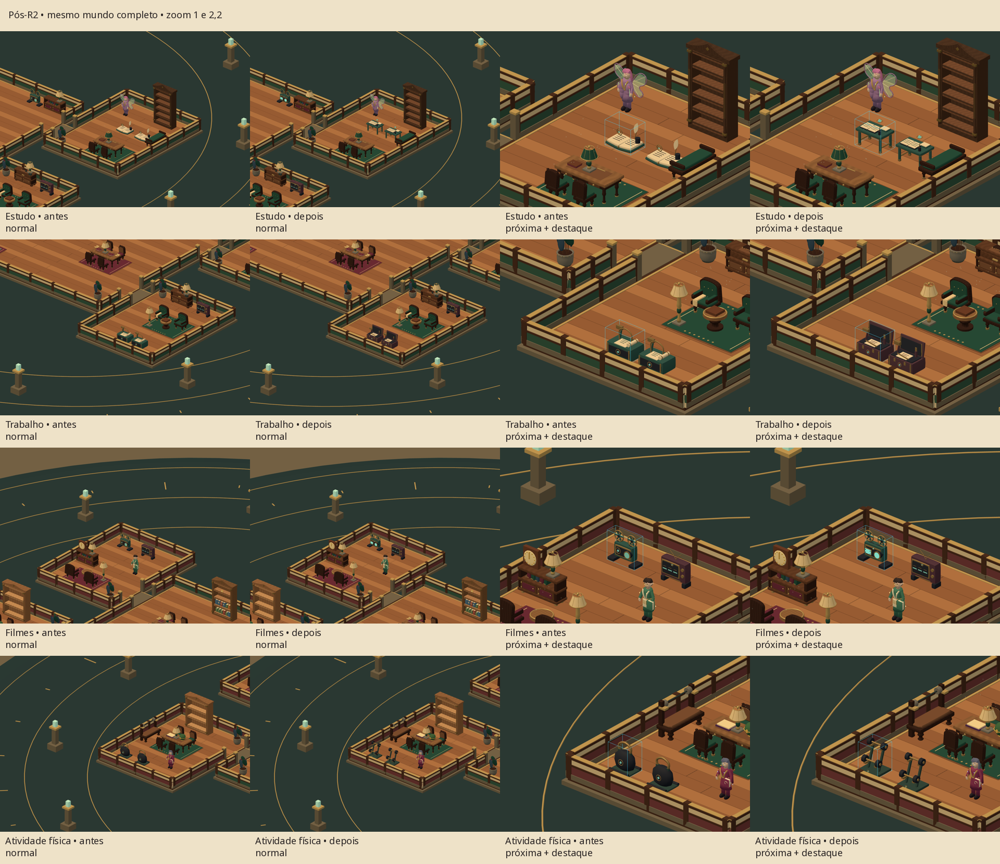

# Evidência visual pós-R2

Mundo completo do ThreeWorldRuntime, corpus fictício e quatro GLBs; Chromium SwiftShader 1280×900/DPR1. Não é ensaio Android nem shell React. [Relatório/método/custos](../../BV_SANEAMENTO_POS_R2.md).

Cada célula liga a PNG de resolução integral. Normal = zoom 1; próxima = zoom 2,2; destaque = mesma próxima selecionada, com helper do runtime.

| Categoria | Antes normal | Depois normal | Antes próxima | Depois próxima | Antes destaque | Depois destaque |
|---|---|---|---|---|---|---|
| Estudo | [PNG](before/record-study-normal.png) | [PNG](after/record-study-normal.png) | [PNG](before/record-study-near.png) | [PNG](after/record-study-near.png) | [PNG](before/record-study-selected.png) | [PNG](after/record-study-selected.png) |
| Trabalho | [PNG](before/record-work-normal.png) | [PNG](after/record-work-normal.png) | [PNG](before/record-work-near.png) | [PNG](after/record-work-near.png) | [PNG](before/record-work-selected.png) | [PNG](after/record-work-selected.png) |
| Filmes | [PNG](before/record-movie-normal.png) | [PNG](after/record-movie-normal.png) | [PNG](before/record-movie-near.png) | [PNG](after/record-movie-near.png) | [PNG](before/record-movie-selected.png) | [PNG](after/record-movie-selected.png) |
| Atividade física | [PNG](before/record-physical_activity-normal.png) | [PNG](after/record-physical_activity-normal.png) | [PNG](before/record-physical_activity-near.png) | [PNG](after/record-physical_activity-near.png) | [PNG](before/record-physical_activity-selected.png) | [PNG](after/record-physical_activity-selected.png) |

[JSON antes](before/metrics.json) · [JSON depois](after/metrics.json). Métricas temporais brutas não isoladas: não usadas como benchmark CPU/GPU/FPS/mobile. Nenhum pageerror; descarte final sem canvas.
